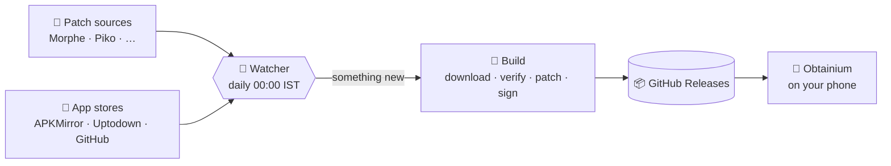

<div align="center">

 

# RVB · ReVanced & Morphe Builder

**Patched Android apps, built automatically and delivered to your phone through Obtainium.**
New patches or a new app version land → a fresh, signed APK appears in Releases. Nothing to build, nothing to remember.

[](OBTAINIUM.md)
[](https://github.com/softpyscho/rvb/releases)
[](https://github.com/softpyscho/rvb/releases)

[](https://github.com/softpyscho/rvb/actions/workflows/ci.yml)
[](https://github.com/softpyscho/rvb/stargazers)
[](LICENSE)


[**Get started**](#-get-started) · [**Apps**](#-supported-applications) · [**How it works**](#-how-it-works) · [**Releases**](https://github.com/softpyscho/rvb/releases) · [**Run your own**](#-run-your-own) · [**Docs**](#-documentation)

</div>

<br>

<table>
<tr>
<td width="33%" valign="top">

### ⚡ Always current
A watcher checks every patch source and app store once a day (00:00 IST) and builds only what moved.

</td>
<td width="33%" valign="top">

### 🔔 Obtainium‑ready
Every app has a one‑tap link with its own file filter. Updates install through Obtainium like any other app, and the update list shows each app's own version (`11.2.0`), not a build number.

</td>
<td width="33%" valign="top">

### 🛡️ Verified, not trusted
Each download is checked for package id, signature and CPU architecture before anything is published.

</td>
</tr>
<tr>
<td valign="top">

### 🧩 Patched
Morphe‑family patches from several maintainers, applied to the stock APK and signed.

</td>
<td valign="top">

### 📦 Mirrored
Apps that publish no GitHub release are re‑hosted **unmodified**, so Obtainium can follow them too.

</td>
<td valign="top">

### 🔔 One build
Every app is built together on its patch author's latest stable release; 🧪 marks a version the patches only list as experimental.

</td>
</tr>
</table>

---

## 🚀 Get started

> [!TIP]
> Open this page **on your phone**: the **Add to Obtainium** badges below hand the app straight to Obtainium.

1. **Install [Obtainium](https://github.com/ImranR98/Obtainium/releases/latest).**
2. **Tap the *Add to Obtainium* badge** next to an app in the table below, then **Add**.
3. **Install it.** Obtainium follows this repository from now on and offers each new build.

Prefer everything at once? Obtainium → *Import/Export* → *Import from file* → [`obtainium-apps.json`](obtainium-apps.json).
Prefer a plain download? Grab the APK from the [latest release](https://github.com/softpyscho/rvb/releases/latest) — each release page lists exactly what that build contains.

> [!NOTE]
> Patched Google apps need [MicroG‑RE](https://github.com/MorpheApp/MicroG-RE/releases/latest) to sign in. Install it once.

---

## 📦 Supported Applications

Grouped by patch source, with the patches applied to each app. Versions and patch lists come from the latest
published build; the table is refreshed by CI after every build from the app config (see
[docs/fork-setup.md](docs/fork-setup.md) to change it).

<!-- APPS_START -->

> **Version** shows the version the patches *recommend* above the version that was *built* (they differ when a source no longer offers the recommended one). **APK Source** is where the stock APK of that build came from. **Channel** says what the build used: ✅ Stable or 🧪 Experimental (a version the patches list only as experimental, so less tested). ⚠️ in **Patches** means a patch the build meant to apply was skipped or failed - open the row to see which and why. For the stock mirrors, **Signature** says whether the file is exactly as its publisher signed it (✅ original, so it updates over the store install) or was signed with this repository's key (⚠️ re-signed: a merged split bundle, which cannot update over the store install and needs an uninstall first).

### 

> **Source:** [`MorpheApp/morphe-patches`](https://github.com/MorpheApp/morphe-patches)

<div align="center">

| App | Version | Channel | APK Source | Patches | Obtainium |
|:---|:-------:|:-------:|:----------:|:--------|:---------:|
| [](https://play.google.com/store/apps/details?id=com.reddit.frontpage) | *recommended: pending*<br>*built: pending* | *(pending)* | *(pending)* | *(Pending first build)*<br>⚙️ appName=Reddit | [](https://apps.obtainium.imranr.dev/redirect?r=obtainium%3A%2F%2Fapp%2F%7B%22id%22%3A%22com.reddit.frontpage%22%2C%22url%22%3A%22https%3A%2F%2Fgithub.com%2Fsoftpyscho%2Frvb%2Freleases%2Fexpanded_assets%2Fstable%22%2C%22author%22%3A%22softpyscho%22%2C%22name%22%3A%22Reddit%22%2C%22installedVersion%22%3A%22%22%2C%22latestVersion%22%3A%22%22%2C%22apkUrls%22%3A%22%5B%5D%22%2C%22otherAssetUrls%22%3A%22%5B%5D%22%2C%22preferredApkIndex%22%3A0%2C%22additionalSettings%22%3A%22%7B%5C%22intermediateLink%5C%22%3A%5B%5D%2C%5C%22customLinkFilterRegex%5C%22%3A%5C%22%2Freddit-morphe-v%5B%5E%2F%5D%2B-arm64-v8a%5C%5C%5C%5C.apk%24%5C%22%2C%5C%22filterByLinkText%5C%22%3Afalse%2C%5C%22matchLinksOutsideATags%5C%22%3Afalse%2C%5C%22skipSort%5C%22%3Afalse%2C%5C%22reverseSort%5C%22%3Afalse%2C%5C%22sortByLastLinkSegment%5C%22%3Atrue%2C%5C%22versionExtractWholePage%5C%22%3Afalse%2C%5C%22requestHeader%5C%22%3A%5B%7B%5C%22requestHeader%5C%22%3A%5C%22User-Agent%3A%20Mozilla%2F5.0%20%28Linux%3B%20Android%2010%3B%20K%29%20AppleWebKit%2F537.36%20%28KHTML%2C%20like%20Gecko%29%20Chrome%2F114.0.0.0%20Mobile%20Safari%2F537.36%5C%22%7D%5D%2C%5C%22defaultPseudoVersioningMethod%5C%22%3A%5C%22partialAPKHash%5C%22%2C%5C%22trackOnly%5C%22%3Afalse%2C%5C%22versionExtractionRegEx%5C%22%3A%5C%22%2Freddit-morphe-v%28.%2B%29-arm64-v8a%5C%5C%5C%5C.apk%24%5C%22%2C%5C%22matchGroupToUse%5C%22%3A%5C%221%5C%22%2C%5C%22versionDetection%5C%22%3Afalse%2C%5C%22useVersionCodeAsOSVersion%5C%22%3Afalse%2C%5C%22apkFilterRegEx%5C%22%3A%5C%22%5C%22%2C%5C%22invertAPKFilter%5C%22%3Afalse%2C%5C%22autoApkFilterByArch%5C%22%3Afalse%2C%5C%22appName%5C%22%3A%5C%22%5C%22%2C%5C%22appAuthor%5C%22%3A%5C%22%5C%22%2C%5C%22shizukuPretendToBeGooglePlay%5C%22%3Afalse%2C%5C%22allowInsecure%5C%22%3Afalse%2C%5C%22exemptFromBackgroundUpdates%5C%22%3Afalse%2C%5C%22skipUpdateNotifications%5C%22%3Afalse%2C%5C%22about%5C%22%3A%5C%22%5C%22%2C%5C%22refreshBeforeDownload%5C%22%3Afalse%7D%22%2C%22lastUpdateCheck%22%3Anull%2C%22pinned%22%3Afalse%2C%22categories%22%3A%5B%5D%2C%22releaseDate%22%3Anull%2C%22changeLog%22%3Anull%2C%22overrideSource%22%3A%22HTML%22%2C%22allowIdChange%22%3Afalse%2C%22pendingRepoRenameUrl%22%3Anull%7D) |

</div>

---

### 

> **Source:** [`arandomhooman/hoomans-morphe-patches`](https://github.com/arandomhooman/hoomans-morphe-patches)

<div align="center">

| App | Version | Channel | APK Source | Patches | Obtainium |
|:---|:-------:|:-------:|:----------:|:--------|:---------:|
| [](https://play.google.com/store/apps/details?id=com.paget96.batteryguru) | *recommended: pending*<br>*built: pending* | *(pending)* | *(pending)* | *(Pending first build)* | [](https://apps.obtainium.imranr.dev/redirect?r=obtainium%3A%2F%2Fapp%2F%7B%22id%22%3A%22com.paget96.batteryguru%22%2C%22url%22%3A%22https%3A%2F%2Fgithub.com%2Fsoftpyscho%2Frvb%2Freleases%2Fexpanded_assets%2Fstable%22%2C%22author%22%3A%22softpyscho%22%2C%22name%22%3A%22Battery%20Guru%22%2C%22installedVersion%22%3A%22%22%2C%22latestVersion%22%3A%22%22%2C%22apkUrls%22%3A%22%5B%5D%22%2C%22otherAssetUrls%22%3A%22%5B%5D%22%2C%22preferredApkIndex%22%3A0%2C%22additionalSettings%22%3A%22%7B%5C%22intermediateLink%5C%22%3A%5B%5D%2C%5C%22customLinkFilterRegex%5C%22%3A%5C%22%2Fbattery-guru-morphe-v%5B%5E%2F%5D%2B-arm64-v8a%5C%5C%5C%5C.apk%24%5C%22%2C%5C%22filterByLinkText%5C%22%3Afalse%2C%5C%22matchLinksOutsideATags%5C%22%3Afalse%2C%5C%22skipSort%5C%22%3Afalse%2C%5C%22reverseSort%5C%22%3Afalse%2C%5C%22sortByLastLinkSegment%5C%22%3Atrue%2C%5C%22versionExtractWholePage%5C%22%3Afalse%2C%5C%22requestHeader%5C%22%3A%5B%7B%5C%22requestHeader%5C%22%3A%5C%22User-Agent%3A%20Mozilla%2F5.0%20%28Linux%3B%20Android%2010%3B%20K%29%20AppleWebKit%2F537.36%20%28KHTML%2C%20like%20Gecko%29%20Chrome%2F114.0.0.0%20Mobile%20Safari%2F537.36%5C%22%7D%5D%2C%5C%22defaultPseudoVersioningMethod%5C%22%3A%5C%22partialAPKHash%5C%22%2C%5C%22trackOnly%5C%22%3Afalse%2C%5C%22versionExtractionRegEx%5C%22%3A%5C%22%2Fbattery-guru-morphe-v%28.%2B%29-arm64-v8a%5C%5C%5C%5C.apk%24%5C%22%2C%5C%22matchGroupToUse%5C%22%3A%5C%221%5C%22%2C%5C%22versionDetection%5C%22%3Afalse%2C%5C%22useVersionCodeAsOSVersion%5C%22%3Afalse%2C%5C%22apkFilterRegEx%5C%22%3A%5C%22%5C%22%2C%5C%22invertAPKFilter%5C%22%3Afalse%2C%5C%22autoApkFilterByArch%5C%22%3Afalse%2C%5C%22appName%5C%22%3A%5C%22%5C%22%2C%5C%22appAuthor%5C%22%3A%5C%22%5C%22%2C%5C%22shizukuPretendToBeGooglePlay%5C%22%3Afalse%2C%5C%22allowInsecure%5C%22%3Afalse%2C%5C%22exemptFromBackgroundUpdates%5C%22%3Afalse%2C%5C%22skipUpdateNotifications%5C%22%3Afalse%2C%5C%22about%5C%22%3A%5C%22%5C%22%2C%5C%22refreshBeforeDownload%5C%22%3Afalse%7D%22%2C%22lastUpdateCheck%22%3Anull%2C%22pinned%22%3Afalse%2C%22categories%22%3A%5B%5D%2C%22releaseDate%22%3Anull%2C%22changeLog%22%3Anull%2C%22overrideSource%22%3A%22HTML%22%2C%22allowIdChange%22%3Afalse%2C%22pendingRepoRenameUrl%22%3Anull%7D) |

</div>

---

### 

> **Source:** [`crimera/piko`](https://github.com/crimera/piko)

<div align="center">

| App | Version | Channel | APK Source | Patches | Obtainium |
|:---|:-------:|:-------:|:----------:|:--------|:---------:|
| [](https://play.google.com/store/apps/details?id=com.twitter.android) | *recommended: pending*<br>*built: pending* | *(pending)* | *(pending)* | *(Pending first build)* | [](https://apps.obtainium.imranr.dev/redirect?r=obtainium%3A%2F%2Fapp%2F%7B%22id%22%3A%22com.twitter.android%22%2C%22url%22%3A%22https%3A%2F%2Fgithub.com%2Fsoftpyscho%2Frvb%2Freleases%2Fexpanded_assets%2Fstable%22%2C%22author%22%3A%22softpyscho%22%2C%22name%22%3A%22Twitter%22%2C%22installedVersion%22%3A%22%22%2C%22latestVersion%22%3A%22%22%2C%22apkUrls%22%3A%22%5B%5D%22%2C%22otherAssetUrls%22%3A%22%5B%5D%22%2C%22preferredApkIndex%22%3A0%2C%22additionalSettings%22%3A%22%7B%5C%22intermediateLink%5C%22%3A%5B%5D%2C%5C%22customLinkFilterRegex%5C%22%3A%5C%22%2Ftwitter-morphe-v%5B%5E%2F%5D%2B-arm64-v8a%5C%5C%5C%5C.apk%24%5C%22%2C%5C%22filterByLinkText%5C%22%3Afalse%2C%5C%22matchLinksOutsideATags%5C%22%3Afalse%2C%5C%22skipSort%5C%22%3Afalse%2C%5C%22reverseSort%5C%22%3Afalse%2C%5C%22sortByLastLinkSegment%5C%22%3Atrue%2C%5C%22versionExtractWholePage%5C%22%3Afalse%2C%5C%22requestHeader%5C%22%3A%5B%7B%5C%22requestHeader%5C%22%3A%5C%22User-Agent%3A%20Mozilla%2F5.0%20%28Linux%3B%20Android%2010%3B%20K%29%20AppleWebKit%2F537.36%20%28KHTML%2C%20like%20Gecko%29%20Chrome%2F114.0.0.0%20Mobile%20Safari%2F537.36%5C%22%7D%5D%2C%5C%22defaultPseudoVersioningMethod%5C%22%3A%5C%22partialAPKHash%5C%22%2C%5C%22trackOnly%5C%22%3Afalse%2C%5C%22versionExtractionRegEx%5C%22%3A%5C%22%2Ftwitter-morphe-v%28.%2B%29-arm64-v8a%5C%5C%5C%5C.apk%24%5C%22%2C%5C%22matchGroupToUse%5C%22%3A%5C%221%5C%22%2C%5C%22versionDetection%5C%22%3Afalse%2C%5C%22useVersionCodeAsOSVersion%5C%22%3Afalse%2C%5C%22apkFilterRegEx%5C%22%3A%5C%22%5C%22%2C%5C%22invertAPKFilter%5C%22%3Afalse%2C%5C%22autoApkFilterByArch%5C%22%3Afalse%2C%5C%22appName%5C%22%3A%5C%22%5C%22%2C%5C%22appAuthor%5C%22%3A%5C%22%5C%22%2C%5C%22shizukuPretendToBeGooglePlay%5C%22%3Afalse%2C%5C%22allowInsecure%5C%22%3Afalse%2C%5C%22exemptFromBackgroundUpdates%5C%22%3Afalse%2C%5C%22skipUpdateNotifications%5C%22%3Afalse%2C%5C%22about%5C%22%3A%5C%22%5C%22%2C%5C%22refreshBeforeDownload%5C%22%3Afalse%7D%22%2C%22lastUpdateCheck%22%3Anull%2C%22pinned%22%3Afalse%2C%22categories%22%3A%5B%5D%2C%22releaseDate%22%3Anull%2C%22changeLog%22%3Anull%2C%22overrideSource%22%3A%22HTML%22%2C%22allowIdChange%22%3Afalse%2C%22pendingRepoRenameUrl%22%3Anull%7D) |
| [](https://play.google.com/store/apps/details?id=com.instagram.android) | *recommended: pending*<br>*built: pending* | *(pending)* | *(pending)* | *(Pending first build)* | [](https://apps.obtainium.imranr.dev/redirect?r=obtainium%3A%2F%2Fapp%2F%7B%22id%22%3A%22com.instagram.android%22%2C%22url%22%3A%22https%3A%2F%2Fgithub.com%2Fsoftpyscho%2Frvb%2Freleases%2Fexpanded_assets%2Fstable%22%2C%22author%22%3A%22softpyscho%22%2C%22name%22%3A%22Instagram%22%2C%22installedVersion%22%3A%22%22%2C%22latestVersion%22%3A%22%22%2C%22apkUrls%22%3A%22%5B%5D%22%2C%22otherAssetUrls%22%3A%22%5B%5D%22%2C%22preferredApkIndex%22%3A0%2C%22additionalSettings%22%3A%22%7B%5C%22intermediateLink%5C%22%3A%5B%5D%2C%5C%22customLinkFilterRegex%5C%22%3A%5C%22%2Finstagram-morphe-v%5B%5E%2F%5D%2B-arm64-v8a%5C%5C%5C%5C.apk%24%5C%22%2C%5C%22filterByLinkText%5C%22%3Afalse%2C%5C%22matchLinksOutsideATags%5C%22%3Afalse%2C%5C%22skipSort%5C%22%3Afalse%2C%5C%22reverseSort%5C%22%3Afalse%2C%5C%22sortByLastLinkSegment%5C%22%3Atrue%2C%5C%22versionExtractWholePage%5C%22%3Afalse%2C%5C%22requestHeader%5C%22%3A%5B%7B%5C%22requestHeader%5C%22%3A%5C%22User-Agent%3A%20Mozilla%2F5.0%20%28Linux%3B%20Android%2010%3B%20K%29%20AppleWebKit%2F537.36%20%28KHTML%2C%20like%20Gecko%29%20Chrome%2F114.0.0.0%20Mobile%20Safari%2F537.36%5C%22%7D%5D%2C%5C%22defaultPseudoVersioningMethod%5C%22%3A%5C%22partialAPKHash%5C%22%2C%5C%22trackOnly%5C%22%3Afalse%2C%5C%22versionExtractionRegEx%5C%22%3A%5C%22%2Finstagram-morphe-v%28.%2B%29-arm64-v8a%5C%5C%5C%5C.apk%24%5C%22%2C%5C%22matchGroupToUse%5C%22%3A%5C%221%5C%22%2C%5C%22versionDetection%5C%22%3Afalse%2C%5C%22useVersionCodeAsOSVersion%5C%22%3Afalse%2C%5C%22apkFilterRegEx%5C%22%3A%5C%22%5C%22%2C%5C%22invertAPKFilter%5C%22%3Afalse%2C%5C%22autoApkFilterByArch%5C%22%3Afalse%2C%5C%22appName%5C%22%3A%5C%22%5C%22%2C%5C%22appAuthor%5C%22%3A%5C%22%5C%22%2C%5C%22shizukuPretendToBeGooglePlay%5C%22%3Afalse%2C%5C%22allowInsecure%5C%22%3Afalse%2C%5C%22exemptFromBackgroundUpdates%5C%22%3Afalse%2C%5C%22skipUpdateNotifications%5C%22%3Afalse%2C%5C%22about%5C%22%3A%5C%22%5C%22%2C%5C%22refreshBeforeDownload%5C%22%3Afalse%7D%22%2C%22lastUpdateCheck%22%3Anull%2C%22pinned%22%3Afalse%2C%22categories%22%3A%5B%5D%2C%22releaseDate%22%3Anull%2C%22changeLog%22%3Anull%2C%22overrideSource%22%3A%22HTML%22%2C%22allowIdChange%22%3Afalse%2C%22pendingRepoRenameUrl%22%3Anull%7D) |

</div>

---

### 

> **Source:** [`hoo-dles/morphe-patches`](https://github.com/hoo-dles/morphe-patches)

<div align="center">

| App | Version | Channel | APK Source | Patches | Obtainium |
|:---|:-------:|:-------:|:----------:|:--------|:---------:|
| [](https://play.google.com/store/apps/details?id=com.xodo.pdf.reader) | *recommended: pending*<br>*built: pending* | *(pending)* | *(pending)* | *(Pending first build)* | [](https://apps.obtainium.imranr.dev/redirect?r=obtainium%3A%2F%2Fapp%2F%7B%22id%22%3A%22com.xodo.pdf.reader%22%2C%22url%22%3A%22https%3A%2F%2Fgithub.com%2Fsoftpyscho%2Frvb%2Freleases%2Fexpanded_assets%2Fstable%22%2C%22author%22%3A%22softpyscho%22%2C%22name%22%3A%22Xodo%22%2C%22installedVersion%22%3A%22%22%2C%22latestVersion%22%3A%22%22%2C%22apkUrls%22%3A%22%5B%5D%22%2C%22otherAssetUrls%22%3A%22%5B%5D%22%2C%22preferredApkIndex%22%3A0%2C%22additionalSettings%22%3A%22%7B%5C%22intermediateLink%5C%22%3A%5B%5D%2C%5C%22customLinkFilterRegex%5C%22%3A%5C%22%2Fxodo-morphe-v%5B%5E%2F%5D%2B-arm64-v8a%5C%5C%5C%5C.apk%24%5C%22%2C%5C%22filterByLinkText%5C%22%3Afalse%2C%5C%22matchLinksOutsideATags%5C%22%3Afalse%2C%5C%22skipSort%5C%22%3Afalse%2C%5C%22reverseSort%5C%22%3Afalse%2C%5C%22sortByLastLinkSegment%5C%22%3Atrue%2C%5C%22versionExtractWholePage%5C%22%3Afalse%2C%5C%22requestHeader%5C%22%3A%5B%7B%5C%22requestHeader%5C%22%3A%5C%22User-Agent%3A%20Mozilla%2F5.0%20%28Linux%3B%20Android%2010%3B%20K%29%20AppleWebKit%2F537.36%20%28KHTML%2C%20like%20Gecko%29%20Chrome%2F114.0.0.0%20Mobile%20Safari%2F537.36%5C%22%7D%5D%2C%5C%22defaultPseudoVersioningMethod%5C%22%3A%5C%22partialAPKHash%5C%22%2C%5C%22trackOnly%5C%22%3Afalse%2C%5C%22versionExtractionRegEx%5C%22%3A%5C%22%2Fxodo-morphe-v%28.%2B%29-arm64-v8a%5C%5C%5C%5C.apk%24%5C%22%2C%5C%22matchGroupToUse%5C%22%3A%5C%221%5C%22%2C%5C%22versionDetection%5C%22%3Afalse%2C%5C%22useVersionCodeAsOSVersion%5C%22%3Afalse%2C%5C%22apkFilterRegEx%5C%22%3A%5C%22%5C%22%2C%5C%22invertAPKFilter%5C%22%3Afalse%2C%5C%22autoApkFilterByArch%5C%22%3Afalse%2C%5C%22appName%5C%22%3A%5C%22%5C%22%2C%5C%22appAuthor%5C%22%3A%5C%22%5C%22%2C%5C%22shizukuPretendToBeGooglePlay%5C%22%3Afalse%2C%5C%22allowInsecure%5C%22%3Afalse%2C%5C%22exemptFromBackgroundUpdates%5C%22%3Afalse%2C%5C%22skipUpdateNotifications%5C%22%3Afalse%2C%5C%22about%5C%22%3A%5C%22%5C%22%2C%5C%22refreshBeforeDownload%5C%22%3Afalse%7D%22%2C%22lastUpdateCheck%22%3Anull%2C%22pinned%22%3Afalse%2C%22categories%22%3A%5B%5D%2C%22releaseDate%22%3Anull%2C%22changeLog%22%3Anull%2C%22overrideSource%22%3A%22HTML%22%2C%22allowIdChange%22%3Afalse%2C%22pendingRepoRenameUrl%22%3Anull%7D) |
| [](https://play.google.com/store/apps/details?id=com.amazon.avod.thirdpartyclient) | *recommended: pending*<br>*built: pending* | *(pending)* | *(pending)* | *(Pending first build)* | [](https://apps.obtainium.imranr.dev/redirect?r=obtainium%3A%2F%2Fapp%2F%7B%22id%22%3A%22com.amazon.avod.thirdpartyclient%22%2C%22url%22%3A%22https%3A%2F%2Fgithub.com%2Fsoftpyscho%2Frvb%2Freleases%2Fexpanded_assets%2Fstable%22%2C%22author%22%3A%22softpyscho%22%2C%22name%22%3A%22Amazon%20Prime%20Video%22%2C%22installedVersion%22%3A%22%22%2C%22latestVersion%22%3A%22%22%2C%22apkUrls%22%3A%22%5B%5D%22%2C%22otherAssetUrls%22%3A%22%5B%5D%22%2C%22preferredApkIndex%22%3A0%2C%22additionalSettings%22%3A%22%7B%5C%22intermediateLink%5C%22%3A%5B%5D%2C%5C%22customLinkFilterRegex%5C%22%3A%5C%22%2Famazon-prime-video-morphe-v%5B%5E%2F%5D%2B-arm64-v8a%5C%5C%5C%5C.apk%24%5C%22%2C%5C%22filterByLinkText%5C%22%3Afalse%2C%5C%22matchLinksOutsideATags%5C%22%3Afalse%2C%5C%22skipSort%5C%22%3Afalse%2C%5C%22reverseSort%5C%22%3Afalse%2C%5C%22sortByLastLinkSegment%5C%22%3Atrue%2C%5C%22versionExtractWholePage%5C%22%3Afalse%2C%5C%22requestHeader%5C%22%3A%5B%7B%5C%22requestHeader%5C%22%3A%5C%22User-Agent%3A%20Mozilla%2F5.0%20%28Linux%3B%20Android%2010%3B%20K%29%20AppleWebKit%2F537.36%20%28KHTML%2C%20like%20Gecko%29%20Chrome%2F114.0.0.0%20Mobile%20Safari%2F537.36%5C%22%7D%5D%2C%5C%22defaultPseudoVersioningMethod%5C%22%3A%5C%22partialAPKHash%5C%22%2C%5C%22trackOnly%5C%22%3Afalse%2C%5C%22versionExtractionRegEx%5C%22%3A%5C%22%2Famazon-prime-video-morphe-v%28.%2B%29-arm64-v8a%5C%5C%5C%5C.apk%24%5C%22%2C%5C%22matchGroupToUse%5C%22%3A%5C%221%5C%22%2C%5C%22versionDetection%5C%22%3Afalse%2C%5C%22useVersionCodeAsOSVersion%5C%22%3Afalse%2C%5C%22apkFilterRegEx%5C%22%3A%5C%22%5C%22%2C%5C%22invertAPKFilter%5C%22%3Afalse%2C%5C%22autoApkFilterByArch%5C%22%3Afalse%2C%5C%22appName%5C%22%3A%5C%22%5C%22%2C%5C%22appAuthor%5C%22%3A%5C%22%5C%22%2C%5C%22shizukuPretendToBeGooglePlay%5C%22%3Afalse%2C%5C%22allowInsecure%5C%22%3Afalse%2C%5C%22exemptFromBackgroundUpdates%5C%22%3Afalse%2C%5C%22skipUpdateNotifications%5C%22%3Afalse%2C%5C%22about%5C%22%3A%5C%22%5C%22%2C%5C%22refreshBeforeDownload%5C%22%3Afalse%7D%22%2C%22lastUpdateCheck%22%3Anull%2C%22pinned%22%3Afalse%2C%22categories%22%3A%5B%5D%2C%22releaseDate%22%3Anull%2C%22changeLog%22%3Anull%2C%22overrideSource%22%3A%22HTML%22%2C%22allowIdChange%22%3Afalse%2C%22pendingRepoRenameUrl%22%3Anull%7D) |

</div>

---

### 

> **Source:** [`Paresh-Maheshwari/paresh-patches`](https://gitlab.com/Paresh-Maheshwari/paresh-patches) (GitLab)

<div align="center">

| App | Version | Channel | APK Source | Patches | Obtainium |
|:---|:-------:|:-------:|:----------:|:--------|:---------:|
| [](https://play.google.com/store/apps/details?id=com.truecaller) | *recommended: pending*<br>*built: pending* | *(pending)* | *(pending)* | *(Pending first build)* | [](https://apps.obtainium.imranr.dev/redirect?r=obtainium%3A%2F%2Fapp%2F%7B%22id%22%3A%22com.truecaller%22%2C%22url%22%3A%22https%3A%2F%2Fgithub.com%2Fsoftpyscho%2Frvb%2Freleases%2Fexpanded_assets%2Fstable%22%2C%22author%22%3A%22softpyscho%22%2C%22name%22%3A%22Truecaller%22%2C%22installedVersion%22%3A%22%22%2C%22latestVersion%22%3A%22%22%2C%22apkUrls%22%3A%22%5B%5D%22%2C%22otherAssetUrls%22%3A%22%5B%5D%22%2C%22preferredApkIndex%22%3A0%2C%22additionalSettings%22%3A%22%7B%5C%22intermediateLink%5C%22%3A%5B%5D%2C%5C%22customLinkFilterRegex%5C%22%3A%5C%22%2Ftruecaller-morphe-v%5B%5E%2F%5D%2B-arm64-v8a%5C%5C%5C%5C.apk%24%5C%22%2C%5C%22filterByLinkText%5C%22%3Afalse%2C%5C%22matchLinksOutsideATags%5C%22%3Afalse%2C%5C%22skipSort%5C%22%3Afalse%2C%5C%22reverseSort%5C%22%3Afalse%2C%5C%22sortByLastLinkSegment%5C%22%3Atrue%2C%5C%22versionExtractWholePage%5C%22%3Afalse%2C%5C%22requestHeader%5C%22%3A%5B%7B%5C%22requestHeader%5C%22%3A%5C%22User-Agent%3A%20Mozilla%2F5.0%20%28Linux%3B%20Android%2010%3B%20K%29%20AppleWebKit%2F537.36%20%28KHTML%2C%20like%20Gecko%29%20Chrome%2F114.0.0.0%20Mobile%20Safari%2F537.36%5C%22%7D%5D%2C%5C%22defaultPseudoVersioningMethod%5C%22%3A%5C%22partialAPKHash%5C%22%2C%5C%22trackOnly%5C%22%3Afalse%2C%5C%22versionExtractionRegEx%5C%22%3A%5C%22%2Ftruecaller-morphe-v%28.%2B%29-arm64-v8a%5C%5C%5C%5C.apk%24%5C%22%2C%5C%22matchGroupToUse%5C%22%3A%5C%221%5C%22%2C%5C%22versionDetection%5C%22%3Afalse%2C%5C%22useVersionCodeAsOSVersion%5C%22%3Afalse%2C%5C%22apkFilterRegEx%5C%22%3A%5C%22%5C%22%2C%5C%22invertAPKFilter%5C%22%3Afalse%2C%5C%22autoApkFilterByArch%5C%22%3Afalse%2C%5C%22appName%5C%22%3A%5C%22%5C%22%2C%5C%22appAuthor%5C%22%3A%5C%22%5C%22%2C%5C%22shizukuPretendToBeGooglePlay%5C%22%3Afalse%2C%5C%22allowInsecure%5C%22%3Afalse%2C%5C%22exemptFromBackgroundUpdates%5C%22%3Afalse%2C%5C%22skipUpdateNotifications%5C%22%3Afalse%2C%5C%22about%5C%22%3A%5C%22%5C%22%2C%5C%22refreshBeforeDownload%5C%22%3Afalse%7D%22%2C%22lastUpdateCheck%22%3Anull%2C%22pinned%22%3Afalse%2C%22categories%22%3A%5B%5D%2C%22releaseDate%22%3Anull%2C%22changeLog%22%3Anull%2C%22overrideSource%22%3A%22HTML%22%2C%22allowIdChange%22%3Afalse%2C%22pendingRepoRenameUrl%22%3Anull%7D) |
| [](https://play.google.com/store/apps/details?id=com.ticktick.task) | *recommended: pending*<br>*built: pending* | *(pending)* | *(pending)* | *(Pending first build)* | [](https://apps.obtainium.imranr.dev/redirect?r=obtainium%3A%2F%2Fapp%2F%7B%22id%22%3A%22com.ticktick.task%22%2C%22url%22%3A%22https%3A%2F%2Fgithub.com%2Fsoftpyscho%2Frvb%2Freleases%2Fexpanded_assets%2Fstable%22%2C%22author%22%3A%22softpyscho%22%2C%22name%22%3A%22TickTick%22%2C%22installedVersion%22%3A%22%22%2C%22latestVersion%22%3A%22%22%2C%22apkUrls%22%3A%22%5B%5D%22%2C%22otherAssetUrls%22%3A%22%5B%5D%22%2C%22preferredApkIndex%22%3A0%2C%22additionalSettings%22%3A%22%7B%5C%22intermediateLink%5C%22%3A%5B%5D%2C%5C%22customLinkFilterRegex%5C%22%3A%5C%22%2Fticktick-morphe-v%5B%5E%2F%5D%2B-arm64-v8a%5C%5C%5C%5C.apk%24%5C%22%2C%5C%22filterByLinkText%5C%22%3Afalse%2C%5C%22matchLinksOutsideATags%5C%22%3Afalse%2C%5C%22skipSort%5C%22%3Afalse%2C%5C%22reverseSort%5C%22%3Afalse%2C%5C%22sortByLastLinkSegment%5C%22%3Atrue%2C%5C%22versionExtractWholePage%5C%22%3Afalse%2C%5C%22requestHeader%5C%22%3A%5B%7B%5C%22requestHeader%5C%22%3A%5C%22User-Agent%3A%20Mozilla%2F5.0%20%28Linux%3B%20Android%2010%3B%20K%29%20AppleWebKit%2F537.36%20%28KHTML%2C%20like%20Gecko%29%20Chrome%2F114.0.0.0%20Mobile%20Safari%2F537.36%5C%22%7D%5D%2C%5C%22defaultPseudoVersioningMethod%5C%22%3A%5C%22partialAPKHash%5C%22%2C%5C%22trackOnly%5C%22%3Afalse%2C%5C%22versionExtractionRegEx%5C%22%3A%5C%22%2Fticktick-morphe-v%28.%2B%29-arm64-v8a%5C%5C%5C%5C.apk%24%5C%22%2C%5C%22matchGroupToUse%5C%22%3A%5C%221%5C%22%2C%5C%22versionDetection%5C%22%3Afalse%2C%5C%22useVersionCodeAsOSVersion%5C%22%3Afalse%2C%5C%22apkFilterRegEx%5C%22%3A%5C%22%5C%22%2C%5C%22invertAPKFilter%5C%22%3Afalse%2C%5C%22autoApkFilterByArch%5C%22%3Afalse%2C%5C%22appName%5C%22%3A%5C%22%5C%22%2C%5C%22appAuthor%5C%22%3A%5C%22%5C%22%2C%5C%22shizukuPretendToBeGooglePlay%5C%22%3Afalse%2C%5C%22allowInsecure%5C%22%3Afalse%2C%5C%22exemptFromBackgroundUpdates%5C%22%3Afalse%2C%5C%22skipUpdateNotifications%5C%22%3Afalse%2C%5C%22about%5C%22%3A%5C%22%5C%22%2C%5C%22refreshBeforeDownload%5C%22%3Afalse%7D%22%2C%22lastUpdateCheck%22%3Anull%2C%22pinned%22%3Afalse%2C%22categories%22%3A%5B%5D%2C%22releaseDate%22%3Anull%2C%22changeLog%22%3Anull%2C%22overrideSource%22%3A%22HTML%22%2C%22allowIdChange%22%3Afalse%2C%22pendingRepoRenameUrl%22%3Anull%7D) |

</div>

---

### 

> **Source:** [`rabilrbl/fluffy-patches`](https://github.com/rabilrbl/fluffy-patches)

<div align="center">

| App | Version | Channel | APK Source | Patches | Obtainium |
|:---|:-------:|:-------:|:----------:|:--------|:---------:|
| [](https://www.apkmirror.com/apk/sleep-tracker-alarm-clock-by-delightroom/alarmy-challenge-alarm-clock) | *recommended: pending*<br>*built: pending* | *(pending)* | *(pending)* | *(Pending first build)* | [](https://apps.obtainium.imranr.dev/redirect?r=obtainium%3A%2F%2Fapp%2F%7B%22id%22%3A%22droom.sleepIfUCan%22%2C%22url%22%3A%22https%3A%2F%2Fgithub.com%2Fsoftpyscho%2Frvb%2Freleases%2Fexpanded_assets%2Fstable%22%2C%22author%22%3A%22softpyscho%22%2C%22name%22%3A%22Alarmy%22%2C%22installedVersion%22%3A%22%22%2C%22latestVersion%22%3A%22%22%2C%22apkUrls%22%3A%22%5B%5D%22%2C%22otherAssetUrls%22%3A%22%5B%5D%22%2C%22preferredApkIndex%22%3A0%2C%22additionalSettings%22%3A%22%7B%5C%22intermediateLink%5C%22%3A%5B%5D%2C%5C%22customLinkFilterRegex%5C%22%3A%5C%22%2Falarmy-morphe-v%5B%5E%2F%5D%2B-arm64-v8a%5C%5C%5C%5C.apk%24%5C%22%2C%5C%22filterByLinkText%5C%22%3Afalse%2C%5C%22matchLinksOutsideATags%5C%22%3Afalse%2C%5C%22skipSort%5C%22%3Afalse%2C%5C%22reverseSort%5C%22%3Afalse%2C%5C%22sortByLastLinkSegment%5C%22%3Atrue%2C%5C%22versionExtractWholePage%5C%22%3Afalse%2C%5C%22requestHeader%5C%22%3A%5B%7B%5C%22requestHeader%5C%22%3A%5C%22User-Agent%3A%20Mozilla%2F5.0%20%28Linux%3B%20Android%2010%3B%20K%29%20AppleWebKit%2F537.36%20%28KHTML%2C%20like%20Gecko%29%20Chrome%2F114.0.0.0%20Mobile%20Safari%2F537.36%5C%22%7D%5D%2C%5C%22defaultPseudoVersioningMethod%5C%22%3A%5C%22partialAPKHash%5C%22%2C%5C%22trackOnly%5C%22%3Afalse%2C%5C%22versionExtractionRegEx%5C%22%3A%5C%22%2Falarmy-morphe-v%28.%2B%29-arm64-v8a%5C%5C%5C%5C.apk%24%5C%22%2C%5C%22matchGroupToUse%5C%22%3A%5C%221%5C%22%2C%5C%22versionDetection%5C%22%3Afalse%2C%5C%22useVersionCodeAsOSVersion%5C%22%3Afalse%2C%5C%22apkFilterRegEx%5C%22%3A%5C%22%5C%22%2C%5C%22invertAPKFilter%5C%22%3Afalse%2C%5C%22autoApkFilterByArch%5C%22%3Afalse%2C%5C%22appName%5C%22%3A%5C%22%5C%22%2C%5C%22appAuthor%5C%22%3A%5C%22%5C%22%2C%5C%22shizukuPretendToBeGooglePlay%5C%22%3Afalse%2C%5C%22allowInsecure%5C%22%3Afalse%2C%5C%22exemptFromBackgroundUpdates%5C%22%3Afalse%2C%5C%22skipUpdateNotifications%5C%22%3Afalse%2C%5C%22about%5C%22%3A%5C%22%5C%22%2C%5C%22refreshBeforeDownload%5C%22%3Afalse%7D%22%2C%22lastUpdateCheck%22%3Anull%2C%22pinned%22%3Afalse%2C%22categories%22%3A%5B%5D%2C%22releaseDate%22%3Anull%2C%22changeLog%22%3Anull%2C%22overrideSource%22%3A%22HTML%22%2C%22allowIdChange%22%3Afalse%2C%22pendingRepoRenameUrl%22%3Anull%7D) |

</div>

---

### 

> **Source:** [`rushiranpise/morphe-patches`](https://github.com/rushiranpise/morphe-patches)

<div align="center">

| App | Version | Channel | APK Source | Patches | Obtainium |
|:---|:-------:|:-------:|:----------:|:--------|:---------:|
| [](https://play.google.com/store/apps/details?id=com.cloudflare.onedotonedotonedotone) | *recommended: pending*<br>*built: pending* | *(pending)* | *(pending)* | *(Pending first build)* | [](https://apps.obtainium.imranr.dev/redirect?r=obtainium%3A%2F%2Fapp%2F%7B%22id%22%3A%22com.cloudflare.onedotonedotonedotone%22%2C%22url%22%3A%22https%3A%2F%2Fgithub.com%2Fsoftpyscho%2Frvb%2Freleases%2Fexpanded_assets%2Fstable%22%2C%22author%22%3A%22softpyscho%22%2C%22name%22%3A%22WARP%22%2C%22installedVersion%22%3A%22%22%2C%22latestVersion%22%3A%22%22%2C%22apkUrls%22%3A%22%5B%5D%22%2C%22otherAssetUrls%22%3A%22%5B%5D%22%2C%22preferredApkIndex%22%3A0%2C%22additionalSettings%22%3A%22%7B%5C%22intermediateLink%5C%22%3A%5B%5D%2C%5C%22customLinkFilterRegex%5C%22%3A%5C%22%2Fwarp-morphe-v%5B%5E%2F%5D%2B-arm64-v8a%5C%5C%5C%5C.apk%24%5C%22%2C%5C%22filterByLinkText%5C%22%3Afalse%2C%5C%22matchLinksOutsideATags%5C%22%3Afalse%2C%5C%22skipSort%5C%22%3Afalse%2C%5C%22reverseSort%5C%22%3Afalse%2C%5C%22sortByLastLinkSegment%5C%22%3Atrue%2C%5C%22versionExtractWholePage%5C%22%3Afalse%2C%5C%22requestHeader%5C%22%3A%5B%7B%5C%22requestHeader%5C%22%3A%5C%22User-Agent%3A%20Mozilla%2F5.0%20%28Linux%3B%20Android%2010%3B%20K%29%20AppleWebKit%2F537.36%20%28KHTML%2C%20like%20Gecko%29%20Chrome%2F114.0.0.0%20Mobile%20Safari%2F537.36%5C%22%7D%5D%2C%5C%22defaultPseudoVersioningMethod%5C%22%3A%5C%22partialAPKHash%5C%22%2C%5C%22trackOnly%5C%22%3Afalse%2C%5C%22versionExtractionRegEx%5C%22%3A%5C%22%2Fwarp-morphe-v%28.%2B%29-arm64-v8a%5C%5C%5C%5C.apk%24%5C%22%2C%5C%22matchGroupToUse%5C%22%3A%5C%221%5C%22%2C%5C%22versionDetection%5C%22%3Afalse%2C%5C%22useVersionCodeAsOSVersion%5C%22%3Afalse%2C%5C%22apkFilterRegEx%5C%22%3A%5C%22%5C%22%2C%5C%22invertAPKFilter%5C%22%3Afalse%2C%5C%22autoApkFilterByArch%5C%22%3Afalse%2C%5C%22appName%5C%22%3A%5C%22%5C%22%2C%5C%22appAuthor%5C%22%3A%5C%22%5C%22%2C%5C%22shizukuPretendToBeGooglePlay%5C%22%3Afalse%2C%5C%22allowInsecure%5C%22%3Afalse%2C%5C%22exemptFromBackgroundUpdates%5C%22%3Afalse%2C%5C%22skipUpdateNotifications%5C%22%3Afalse%2C%5C%22about%5C%22%3A%5C%22%5C%22%2C%5C%22refreshBeforeDownload%5C%22%3Afalse%7D%22%2C%22lastUpdateCheck%22%3Anull%2C%22pinned%22%3Afalse%2C%22categories%22%3A%5B%5D%2C%22releaseDate%22%3Anull%2C%22changeLog%22%3Anull%2C%22overrideSource%22%3A%22HTML%22%2C%22allowIdChange%22%3Afalse%2C%22pendingRepoRenameUrl%22%3Anull%7D) |
| [](https://www.apkmirror.com/apk/splitwise/splitwise) | *recommended: pending*<br>*built: pending* | *(pending)* | *(pending)* | *(Pending first build)* | [](https://apps.obtainium.imranr.dev/redirect?r=obtainium%3A%2F%2Fapp%2F%7B%22id%22%3A%22com.Splitwise.SplitwiseMobile%22%2C%22url%22%3A%22https%3A%2F%2Fgithub.com%2Fsoftpyscho%2Frvb%2Freleases%2Fexpanded_assets%2Fstable%22%2C%22author%22%3A%22softpyscho%22%2C%22name%22%3A%22Splitwise%22%2C%22installedVersion%22%3A%22%22%2C%22latestVersion%22%3A%22%22%2C%22apkUrls%22%3A%22%5B%5D%22%2C%22otherAssetUrls%22%3A%22%5B%5D%22%2C%22preferredApkIndex%22%3A0%2C%22additionalSettings%22%3A%22%7B%5C%22intermediateLink%5C%22%3A%5B%5D%2C%5C%22customLinkFilterRegex%5C%22%3A%5C%22%2Fsplitwise-morphe-v%5B%5E%2F%5D%2B-arm64-v8a%5C%5C%5C%5C.apk%24%5C%22%2C%5C%22filterByLinkText%5C%22%3Afalse%2C%5C%22matchLinksOutsideATags%5C%22%3Afalse%2C%5C%22skipSort%5C%22%3Afalse%2C%5C%22reverseSort%5C%22%3Afalse%2C%5C%22sortByLastLinkSegment%5C%22%3Atrue%2C%5C%22versionExtractWholePage%5C%22%3Afalse%2C%5C%22requestHeader%5C%22%3A%5B%7B%5C%22requestHeader%5C%22%3A%5C%22User-Agent%3A%20Mozilla%2F5.0%20%28Linux%3B%20Android%2010%3B%20K%29%20AppleWebKit%2F537.36%20%28KHTML%2C%20like%20Gecko%29%20Chrome%2F114.0.0.0%20Mobile%20Safari%2F537.36%5C%22%7D%5D%2C%5C%22defaultPseudoVersioningMethod%5C%22%3A%5C%22partialAPKHash%5C%22%2C%5C%22trackOnly%5C%22%3Afalse%2C%5C%22versionExtractionRegEx%5C%22%3A%5C%22%2Fsplitwise-morphe-v%28.%2B%29-arm64-v8a%5C%5C%5C%5C.apk%24%5C%22%2C%5C%22matchGroupToUse%5C%22%3A%5C%221%5C%22%2C%5C%22versionDetection%5C%22%3Afalse%2C%5C%22useVersionCodeAsOSVersion%5C%22%3Afalse%2C%5C%22apkFilterRegEx%5C%22%3A%5C%22%5C%22%2C%5C%22invertAPKFilter%5C%22%3Afalse%2C%5C%22autoApkFilterByArch%5C%22%3Afalse%2C%5C%22appName%5C%22%3A%5C%22%5C%22%2C%5C%22appAuthor%5C%22%3A%5C%22%5C%22%2C%5C%22shizukuPretendToBeGooglePlay%5C%22%3Afalse%2C%5C%22allowInsecure%5C%22%3Afalse%2C%5C%22exemptFromBackgroundUpdates%5C%22%3Afalse%2C%5C%22skipUpdateNotifications%5C%22%3Afalse%2C%5C%22about%5C%22%3A%5C%22%5C%22%2C%5C%22refreshBeforeDownload%5C%22%3Afalse%7D%22%2C%22lastUpdateCheck%22%3Anull%2C%22pinned%22%3Afalse%2C%22categories%22%3A%5B%5D%2C%22releaseDate%22%3Anull%2C%22changeLog%22%3Anull%2C%22overrideSource%22%3A%22HTML%22%2C%22allowIdChange%22%3Afalse%2C%22pendingRepoRenameUrl%22%3Anull%7D) |
| [](https://play.google.com/store/apps/details?id=com.adobe.scan.android) | *recommended: pending*<br>*built: pending* | *(pending)* | *(pending)* | *(Pending first build)* | [](https://apps.obtainium.imranr.dev/redirect?r=obtainium%3A%2F%2Fapp%2F%7B%22id%22%3A%22com.adobe.scan.android%22%2C%22url%22%3A%22https%3A%2F%2Fgithub.com%2Fsoftpyscho%2Frvb%2Freleases%2Fexpanded_assets%2Fstable%22%2C%22author%22%3A%22softpyscho%22%2C%22name%22%3A%22Adobe%20Scan%22%2C%22installedVersion%22%3A%22%22%2C%22latestVersion%22%3A%22%22%2C%22apkUrls%22%3A%22%5B%5D%22%2C%22otherAssetUrls%22%3A%22%5B%5D%22%2C%22preferredApkIndex%22%3A0%2C%22additionalSettings%22%3A%22%7B%5C%22intermediateLink%5C%22%3A%5B%5D%2C%5C%22customLinkFilterRegex%5C%22%3A%5C%22%2Fadobe-scan-morphe-v%5B%5E%2F%5D%2B-arm64-v8a%5C%5C%5C%5C.apk%24%5C%22%2C%5C%22filterByLinkText%5C%22%3Afalse%2C%5C%22matchLinksOutsideATags%5C%22%3Afalse%2C%5C%22skipSort%5C%22%3Afalse%2C%5C%22reverseSort%5C%22%3Afalse%2C%5C%22sortByLastLinkSegment%5C%22%3Atrue%2C%5C%22versionExtractWholePage%5C%22%3Afalse%2C%5C%22requestHeader%5C%22%3A%5B%7B%5C%22requestHeader%5C%22%3A%5C%22User-Agent%3A%20Mozilla%2F5.0%20%28Linux%3B%20Android%2010%3B%20K%29%20AppleWebKit%2F537.36%20%28KHTML%2C%20like%20Gecko%29%20Chrome%2F114.0.0.0%20Mobile%20Safari%2F537.36%5C%22%7D%5D%2C%5C%22defaultPseudoVersioningMethod%5C%22%3A%5C%22partialAPKHash%5C%22%2C%5C%22trackOnly%5C%22%3Afalse%2C%5C%22versionExtractionRegEx%5C%22%3A%5C%22%2Fadobe-scan-morphe-v%28.%2B%29-arm64-v8a%5C%5C%5C%5C.apk%24%5C%22%2C%5C%22matchGroupToUse%5C%22%3A%5C%221%5C%22%2C%5C%22versionDetection%5C%22%3Afalse%2C%5C%22useVersionCodeAsOSVersion%5C%22%3Afalse%2C%5C%22apkFilterRegEx%5C%22%3A%5C%22%5C%22%2C%5C%22invertAPKFilter%5C%22%3Afalse%2C%5C%22autoApkFilterByArch%5C%22%3Afalse%2C%5C%22appName%5C%22%3A%5C%22%5C%22%2C%5C%22appAuthor%5C%22%3A%5C%22%5C%22%2C%5C%22shizukuPretendToBeGooglePlay%5C%22%3Afalse%2C%5C%22allowInsecure%5C%22%3Afalse%2C%5C%22exemptFromBackgroundUpdates%5C%22%3Afalse%2C%5C%22skipUpdateNotifications%5C%22%3Afalse%2C%5C%22about%5C%22%3A%5C%22%5C%22%2C%5C%22refreshBeforeDownload%5C%22%3Afalse%7D%22%2C%22lastUpdateCheck%22%3Anull%2C%22pinned%22%3Afalse%2C%22categories%22%3A%5B%5D%2C%22releaseDate%22%3Anull%2C%22changeLog%22%3Anull%2C%22overrideSource%22%3A%22HTML%22%2C%22allowIdChange%22%3Afalse%2C%22pendingRepoRenameUrl%22%3Anull%7D) |
| [](https://play.google.com/store/apps/details?id=com.oasisfeng.greenify) | *recommended: pending*<br>*built: pending* | *(pending)* | *(pending)* | *(Pending first build)* | [](https://apps.obtainium.imranr.dev/redirect?r=obtainium%3A%2F%2Fapp%2F%7B%22id%22%3A%22com.oasisfeng.greenify%22%2C%22url%22%3A%22https%3A%2F%2Fgithub.com%2Fsoftpyscho%2Frvb%2Freleases%2Fexpanded_assets%2Fstable%22%2C%22author%22%3A%22softpyscho%22%2C%22name%22%3A%22Greenify%22%2C%22installedVersion%22%3A%22%22%2C%22latestVersion%22%3A%22%22%2C%22apkUrls%22%3A%22%5B%5D%22%2C%22otherAssetUrls%22%3A%22%5B%5D%22%2C%22preferredApkIndex%22%3A0%2C%22additionalSettings%22%3A%22%7B%5C%22intermediateLink%5C%22%3A%5B%5D%2C%5C%22customLinkFilterRegex%5C%22%3A%5C%22%2Fgreenify-morphe-v%5B%5E%2F%5D%2B-arm64-v8a%5C%5C%5C%5C.apk%24%5C%22%2C%5C%22filterByLinkText%5C%22%3Afalse%2C%5C%22matchLinksOutsideATags%5C%22%3Afalse%2C%5C%22skipSort%5C%22%3Afalse%2C%5C%22reverseSort%5C%22%3Afalse%2C%5C%22sortByLastLinkSegment%5C%22%3Atrue%2C%5C%22versionExtractWholePage%5C%22%3Afalse%2C%5C%22requestHeader%5C%22%3A%5B%7B%5C%22requestHeader%5C%22%3A%5C%22User-Agent%3A%20Mozilla%2F5.0%20%28Linux%3B%20Android%2010%3B%20K%29%20AppleWebKit%2F537.36%20%28KHTML%2C%20like%20Gecko%29%20Chrome%2F114.0.0.0%20Mobile%20Safari%2F537.36%5C%22%7D%5D%2C%5C%22defaultPseudoVersioningMethod%5C%22%3A%5C%22partialAPKHash%5C%22%2C%5C%22trackOnly%5C%22%3Afalse%2C%5C%22versionExtractionRegEx%5C%22%3A%5C%22%2Fgreenify-morphe-v%28.%2B%29-arm64-v8a%5C%5C%5C%5C.apk%24%5C%22%2C%5C%22matchGroupToUse%5C%22%3A%5C%221%5C%22%2C%5C%22versionDetection%5C%22%3Afalse%2C%5C%22useVersionCodeAsOSVersion%5C%22%3Afalse%2C%5C%22apkFilterRegEx%5C%22%3A%5C%22%5C%22%2C%5C%22invertAPKFilter%5C%22%3Afalse%2C%5C%22autoApkFilterByArch%5C%22%3Afalse%2C%5C%22appName%5C%22%3A%5C%22%5C%22%2C%5C%22appAuthor%5C%22%3A%5C%22%5C%22%2C%5C%22shizukuPretendToBeGooglePlay%5C%22%3Afalse%2C%5C%22allowInsecure%5C%22%3Afalse%2C%5C%22exemptFromBackgroundUpdates%5C%22%3Afalse%2C%5C%22skipUpdateNotifications%5C%22%3Afalse%2C%5C%22about%5C%22%3A%5C%22%5C%22%2C%5C%22refreshBeforeDownload%5C%22%3Afalse%7D%22%2C%22lastUpdateCheck%22%3Anull%2C%22pinned%22%3Afalse%2C%22categories%22%3A%5B%5D%2C%22releaseDate%22%3Anull%2C%22changeLog%22%3Anull%2C%22overrideSource%22%3A%22HTML%22%2C%22allowIdChange%22%3Afalse%2C%22pendingRepoRenameUrl%22%3Anull%7D) |

</div>

---

### 

> **Source:** Direct stock APK mirrors (Unpatched)

<div align="center">

| App | Version | APK Source | Signature | Obtainium |
|:---|:-------:|:----------:|:---------:|:---------:|
| [](https://play.google.com/store/apps/details?id=com.stremio.one) |  | Direct | ✅ original · *re-sign allowed* | [](https://apps.obtainium.imranr.dev/redirect?r=obtainium%3A%2F%2Fapp%2F%7B%22id%22%3A%22com.stremio.one%22%2C%22url%22%3A%22https%3A%2F%2Fgithub.com%2Fsoftpyscho%2Frvb%2Freleases%2Fexpanded_assets%2Fstable%22%2C%22author%22%3A%22softpyscho%22%2C%22name%22%3A%22Stremio%22%2C%22installedVersion%22%3A%22%22%2C%22latestVersion%22%3A%22%22%2C%22apkUrls%22%3A%22%5B%5D%22%2C%22otherAssetUrls%22%3A%22%5B%5D%22%2C%22preferredApkIndex%22%3A0%2C%22additionalSettings%22%3A%22%7B%5C%22intermediateLink%5C%22%3A%5B%5D%2C%5C%22customLinkFilterRegex%5C%22%3A%5C%22%2Fstremio-v%5B%5E%2F%5D%2B-arm64-v8a%5C%5C%5C%5C.apk%24%5C%22%2C%5C%22filterByLinkText%5C%22%3Afalse%2C%5C%22matchLinksOutsideATags%5C%22%3Afalse%2C%5C%22skipSort%5C%22%3Afalse%2C%5C%22reverseSort%5C%22%3Afalse%2C%5C%22sortByLastLinkSegment%5C%22%3Atrue%2C%5C%22versionExtractWholePage%5C%22%3Afalse%2C%5C%22requestHeader%5C%22%3A%5B%7B%5C%22requestHeader%5C%22%3A%5C%22User-Agent%3A%20Mozilla%2F5.0%20%28Linux%3B%20Android%2010%3B%20K%29%20AppleWebKit%2F537.36%20%28KHTML%2C%20like%20Gecko%29%20Chrome%2F114.0.0.0%20Mobile%20Safari%2F537.36%5C%22%7D%5D%2C%5C%22defaultPseudoVersioningMethod%5C%22%3A%5C%22partialAPKHash%5C%22%2C%5C%22trackOnly%5C%22%3Afalse%2C%5C%22versionExtractionRegEx%5C%22%3A%5C%22%2Fstremio-v%28.%2B%29-arm64-v8a%5C%5C%5C%5C.apk%24%5C%22%2C%5C%22matchGroupToUse%5C%22%3A%5C%221%5C%22%2C%5C%22versionDetection%5C%22%3Atrue%2C%5C%22useVersionCodeAsOSVersion%5C%22%3Afalse%2C%5C%22apkFilterRegEx%5C%22%3A%5C%22%5C%22%2C%5C%22invertAPKFilter%5C%22%3Afalse%2C%5C%22autoApkFilterByArch%5C%22%3Afalse%2C%5C%22appName%5C%22%3A%5C%22%5C%22%2C%5C%22appAuthor%5C%22%3A%5C%22%5C%22%2C%5C%22shizukuPretendToBeGooglePlay%5C%22%3Afalse%2C%5C%22allowInsecure%5C%22%3Afalse%2C%5C%22exemptFromBackgroundUpdates%5C%22%3Afalse%2C%5C%22skipUpdateNotifications%5C%22%3Afalse%2C%5C%22about%5C%22%3A%5C%22%5C%22%2C%5C%22refreshBeforeDownload%5C%22%3Afalse%7D%22%2C%22lastUpdateCheck%22%3Anull%2C%22pinned%22%3Afalse%2C%22categories%22%3A%5B%5D%2C%22releaseDate%22%3Anull%2C%22changeLog%22%3Anull%2C%22overrideSource%22%3A%22HTML%22%2C%22allowIdChange%22%3Afalse%2C%22pendingRepoRenameUrl%22%3Anull%7D) |
| [](https://play.google.com/store/apps/details?id=com.mixplorer) |  | *(pending)* | *(pending)* | [](https://apps.obtainium.imranr.dev/redirect?r=obtainium%3A%2F%2Fapp%2F%7B%22id%22%3A%22com.mixplorer%22%2C%22url%22%3A%22https%3A%2F%2Fgithub.com%2Fsoftpyscho%2Frvb%2Freleases%2Fexpanded_assets%2Fstable%22%2C%22author%22%3A%22softpyscho%22%2C%22name%22%3A%22Mixplorer%22%2C%22installedVersion%22%3A%22%22%2C%22latestVersion%22%3A%22%22%2C%22apkUrls%22%3A%22%5B%5D%22%2C%22otherAssetUrls%22%3A%22%5B%5D%22%2C%22preferredApkIndex%22%3A0%2C%22additionalSettings%22%3A%22%7B%5C%22intermediateLink%5C%22%3A%5B%5D%2C%5C%22customLinkFilterRegex%5C%22%3A%5C%22%2Fmixplorer-v%5B%5E%2F%5D%2B-arm64-v8a%5C%5C%5C%5C.apk%24%5C%22%2C%5C%22filterByLinkText%5C%22%3Afalse%2C%5C%22matchLinksOutsideATags%5C%22%3Afalse%2C%5C%22skipSort%5C%22%3Afalse%2C%5C%22reverseSort%5C%22%3Afalse%2C%5C%22sortByLastLinkSegment%5C%22%3Atrue%2C%5C%22versionExtractWholePage%5C%22%3Afalse%2C%5C%22requestHeader%5C%22%3A%5B%7B%5C%22requestHeader%5C%22%3A%5C%22User-Agent%3A%20Mozilla%2F5.0%20%28Linux%3B%20Android%2010%3B%20K%29%20AppleWebKit%2F537.36%20%28KHTML%2C%20like%20Gecko%29%20Chrome%2F114.0.0.0%20Mobile%20Safari%2F537.36%5C%22%7D%5D%2C%5C%22defaultPseudoVersioningMethod%5C%22%3A%5C%22partialAPKHash%5C%22%2C%5C%22trackOnly%5C%22%3Afalse%2C%5C%22versionExtractionRegEx%5C%22%3A%5C%22%2Fmixplorer-v%28.%2B%29-arm64-v8a%5C%5C%5C%5C.apk%24%5C%22%2C%5C%22matchGroupToUse%5C%22%3A%5C%221%5C%22%2C%5C%22versionDetection%5C%22%3Atrue%2C%5C%22useVersionCodeAsOSVersion%5C%22%3Afalse%2C%5C%22apkFilterRegEx%5C%22%3A%5C%22%5C%22%2C%5C%22invertAPKFilter%5C%22%3Afalse%2C%5C%22autoApkFilterByArch%5C%22%3Afalse%2C%5C%22appName%5C%22%3A%5C%22%5C%22%2C%5C%22appAuthor%5C%22%3A%5C%22%5C%22%2C%5C%22shizukuPretendToBeGooglePlay%5C%22%3Afalse%2C%5C%22allowInsecure%5C%22%3Afalse%2C%5C%22exemptFromBackgroundUpdates%5C%22%3Afalse%2C%5C%22skipUpdateNotifications%5C%22%3Afalse%2C%5C%22about%5C%22%3A%5C%22%5C%22%2C%5C%22refreshBeforeDownload%5C%22%3Afalse%7D%22%2C%22lastUpdateCheck%22%3Anull%2C%22pinned%22%3Afalse%2C%22categories%22%3A%5B%5D%2C%22releaseDate%22%3Anull%2C%22changeLog%22%3Anull%2C%22overrideSource%22%3A%22HTML%22%2C%22allowIdChange%22%3Afalse%2C%22pendingRepoRenameUrl%22%3Anull%7D) |
| [](https://play.google.com/store/apps/details?id=com.mixplorer.addon.archive) |  | *(pending)* | *(pending)* | [](https://apps.obtainium.imranr.dev/redirect?r=obtainium%3A%2F%2Fapp%2F%7B%22id%22%3A%22com.mixplorer.addon.archive%22%2C%22url%22%3A%22https%3A%2F%2Fgithub.com%2Fsoftpyscho%2Frvb%2Freleases%2Fexpanded_assets%2Fstable%22%2C%22author%22%3A%22softpyscho%22%2C%22name%22%3A%22Mix%20Archive%22%2C%22installedVersion%22%3A%22%22%2C%22latestVersion%22%3A%22%22%2C%22apkUrls%22%3A%22%5B%5D%22%2C%22otherAssetUrls%22%3A%22%5B%5D%22%2C%22preferredApkIndex%22%3A0%2C%22additionalSettings%22%3A%22%7B%5C%22intermediateLink%5C%22%3A%5B%5D%2C%5C%22customLinkFilterRegex%5C%22%3A%5C%22%2Fmix-archive-v%5B%5E%2F%5D%2B-arm64-v8a%5C%5C%5C%5C.apk%24%5C%22%2C%5C%22filterByLinkText%5C%22%3Afalse%2C%5C%22matchLinksOutsideATags%5C%22%3Afalse%2C%5C%22skipSort%5C%22%3Afalse%2C%5C%22reverseSort%5C%22%3Afalse%2C%5C%22sortByLastLinkSegment%5C%22%3Atrue%2C%5C%22versionExtractWholePage%5C%22%3Afalse%2C%5C%22requestHeader%5C%22%3A%5B%7B%5C%22requestHeader%5C%22%3A%5C%22User-Agent%3A%20Mozilla%2F5.0%20%28Linux%3B%20Android%2010%3B%20K%29%20AppleWebKit%2F537.36%20%28KHTML%2C%20like%20Gecko%29%20Chrome%2F114.0.0.0%20Mobile%20Safari%2F537.36%5C%22%7D%5D%2C%5C%22defaultPseudoVersioningMethod%5C%22%3A%5C%22partialAPKHash%5C%22%2C%5C%22trackOnly%5C%22%3Afalse%2C%5C%22versionExtractionRegEx%5C%22%3A%5C%22%2Fmix-archive-v%28.%2B%29-arm64-v8a%5C%5C%5C%5C.apk%24%5C%22%2C%5C%22matchGroupToUse%5C%22%3A%5C%221%5C%22%2C%5C%22versionDetection%5C%22%3Atrue%2C%5C%22useVersionCodeAsOSVersion%5C%22%3Afalse%2C%5C%22apkFilterRegEx%5C%22%3A%5C%22%5C%22%2C%5C%22invertAPKFilter%5C%22%3Afalse%2C%5C%22autoApkFilterByArch%5C%22%3Afalse%2C%5C%22appName%5C%22%3A%5C%22%5C%22%2C%5C%22appAuthor%5C%22%3A%5C%22%5C%22%2C%5C%22shizukuPretendToBeGooglePlay%5C%22%3Afalse%2C%5C%22allowInsecure%5C%22%3Afalse%2C%5C%22exemptFromBackgroundUpdates%5C%22%3Afalse%2C%5C%22skipUpdateNotifications%5C%22%3Afalse%2C%5C%22about%5C%22%3A%5C%22%5C%22%2C%5C%22refreshBeforeDownload%5C%22%3Afalse%7D%22%2C%22lastUpdateCheck%22%3Anull%2C%22pinned%22%3Afalse%2C%22categories%22%3A%5B%5D%2C%22releaseDate%22%3Anull%2C%22changeLog%22%3Anull%2C%22overrideSource%22%3A%22HTML%22%2C%22allowIdChange%22%3Afalse%2C%22pendingRepoRenameUrl%22%3Anull%7D) |
| [](https://github.com/eltavine/Duck-Detector-Refactoring) |  | *(pending)* | *(pending)* | [](https://apps.obtainium.imranr.dev/redirect?r=obtainium%3A%2F%2Fapp%2F%7B%22id%22%3A%22com.eltavine.duckdetector%22%2C%22url%22%3A%22https%3A%2F%2Fgithub.com%2Fsoftpyscho%2Frvb%2Freleases%2Fexpanded_assets%2Fstable%22%2C%22author%22%3A%22softpyscho%22%2C%22name%22%3A%22Duck%20Detector%22%2C%22installedVersion%22%3A%22%22%2C%22latestVersion%22%3A%22%22%2C%22apkUrls%22%3A%22%5B%5D%22%2C%22otherAssetUrls%22%3A%22%5B%5D%22%2C%22preferredApkIndex%22%3A0%2C%22additionalSettings%22%3A%22%7B%5C%22intermediateLink%5C%22%3A%5B%5D%2C%5C%22customLinkFilterRegex%5C%22%3A%5C%22%2FDuck%5B._-%5D%3FDetector-%5B%5E%2F%5D%2B%5C%5C%5C%5C.apk%24%5C%22%2C%5C%22filterByLinkText%5C%22%3Afalse%2C%5C%22matchLinksOutsideATags%5C%22%3Afalse%2C%5C%22skipSort%5C%22%3Afalse%2C%5C%22reverseSort%5C%22%3Afalse%2C%5C%22sortByLastLinkSegment%5C%22%3Atrue%2C%5C%22versionExtractWholePage%5C%22%3Afalse%2C%5C%22requestHeader%5C%22%3A%5B%7B%5C%22requestHeader%5C%22%3A%5C%22User-Agent%3A%20Mozilla%2F5.0%20%28Linux%3B%20Android%2010%3B%20K%29%20AppleWebKit%2F537.36%20%28KHTML%2C%20like%20Gecko%29%20Chrome%2F114.0.0.0%20Mobile%20Safari%2F537.36%5C%22%7D%5D%2C%5C%22defaultPseudoVersioningMethod%5C%22%3A%5C%22partialAPKHash%5C%22%2C%5C%22trackOnly%5C%22%3Afalse%2C%5C%22versionExtractionRegEx%5C%22%3A%5C%22%2FDuck%5B._-%5D%3FDetector-%28.%2B%29%5C%5C%5C%5C.apk%24%5C%22%2C%5C%22matchGroupToUse%5C%22%3A%5C%221%5C%22%2C%5C%22versionDetection%5C%22%3Atrue%2C%5C%22useVersionCodeAsOSVersion%5C%22%3Afalse%2C%5C%22apkFilterRegEx%5C%22%3A%5C%22%5C%22%2C%5C%22invertAPKFilter%5C%22%3Afalse%2C%5C%22autoApkFilterByArch%5C%22%3Afalse%2C%5C%22appName%5C%22%3A%5C%22%5C%22%2C%5C%22appAuthor%5C%22%3A%5C%22%5C%22%2C%5C%22shizukuPretendToBeGooglePlay%5C%22%3Afalse%2C%5C%22allowInsecure%5C%22%3Afalse%2C%5C%22exemptFromBackgroundUpdates%5C%22%3Afalse%2C%5C%22skipUpdateNotifications%5C%22%3Afalse%2C%5C%22about%5C%22%3A%5C%22%5C%22%2C%5C%22refreshBeforeDownload%5C%22%3Afalse%7D%22%2C%22lastUpdateCheck%22%3Anull%2C%22pinned%22%3Afalse%2C%22categories%22%3A%5B%5D%2C%22releaseDate%22%3Anull%2C%22changeLog%22%3Anull%2C%22overrideSource%22%3A%22HTML%22%2C%22allowIdChange%22%3Afalse%2C%22pendingRepoRenameUrl%22%3Anull%7D) |
| [](https://github.com/DHD2280/Oxygen-Customizer/actions/workflows/build_debug.yml) |  | *(pending)* | *(pending)* | [](https://apps.obtainium.imranr.dev/redirect?r=obtainium%3A%2F%2Fapp%2F%7B%22id%22%3A%22it.dhd.oxygencustomizer%22%2C%22url%22%3A%22https%3A%2F%2Fgithub.com%2Fsoftpyscho%2Frvb%2Freleases%2Fexpanded_assets%2Fstable%22%2C%22author%22%3A%22softpyscho%22%2C%22name%22%3A%22Oxygen%20Customizer%22%2C%22installedVersion%22%3A%22%22%2C%22latestVersion%22%3A%22%22%2C%22apkUrls%22%3A%22%5B%5D%22%2C%22otherAssetUrls%22%3A%22%5B%5D%22%2C%22preferredApkIndex%22%3A0%2C%22additionalSettings%22%3A%22%7B%5C%22intermediateLink%5C%22%3A%5B%5D%2C%5C%22customLinkFilterRegex%5C%22%3A%5C%22%2Foxygen-customizer-v%5B%5E%2F%5D%2B-%28all%7Cuniversal%29%5C%5C%5C%5C.apk%24%5C%22%2C%5C%22filterByLinkText%5C%22%3Afalse%2C%5C%22matchLinksOutsideATags%5C%22%3Afalse%2C%5C%22skipSort%5C%22%3Afalse%2C%5C%22reverseSort%5C%22%3Afalse%2C%5C%22sortByLastLinkSegment%5C%22%3Atrue%2C%5C%22versionExtractWholePage%5C%22%3Afalse%2C%5C%22requestHeader%5C%22%3A%5B%7B%5C%22requestHeader%5C%22%3A%5C%22User-Agent%3A%20Mozilla%2F5.0%20%28Linux%3B%20Android%2010%3B%20K%29%20AppleWebKit%2F537.36%20%28KHTML%2C%20like%20Gecko%29%20Chrome%2F114.0.0.0%20Mobile%20Safari%2F537.36%5C%22%7D%5D%2C%5C%22defaultPseudoVersioningMethod%5C%22%3A%5C%22partialAPKHash%5C%22%2C%5C%22trackOnly%5C%22%3Afalse%2C%5C%22versionExtractionRegEx%5C%22%3A%5C%22%2Foxygen-customizer-v%28.%2B%29-%28all%7Cuniversal%29%5C%5C%5C%5C.apk%24%5C%22%2C%5C%22matchGroupToUse%5C%22%3A%5C%221%5C%22%2C%5C%22versionDetection%5C%22%3Atrue%2C%5C%22useVersionCodeAsOSVersion%5C%22%3Afalse%2C%5C%22apkFilterRegEx%5C%22%3A%5C%22%5C%22%2C%5C%22invertAPKFilter%5C%22%3Afalse%2C%5C%22autoApkFilterByArch%5C%22%3Afalse%2C%5C%22appName%5C%22%3A%5C%22%5C%22%2C%5C%22appAuthor%5C%22%3A%5C%22%5C%22%2C%5C%22shizukuPretendToBeGooglePlay%5C%22%3Afalse%2C%5C%22allowInsecure%5C%22%3Afalse%2C%5C%22exemptFromBackgroundUpdates%5C%22%3Afalse%2C%5C%22skipUpdateNotifications%5C%22%3Afalse%2C%5C%22about%5C%22%3A%5C%22%5C%22%2C%5C%22refreshBeforeDownload%5C%22%3Afalse%7D%22%2C%22lastUpdateCheck%22%3Anull%2C%22pinned%22%3Afalse%2C%22categories%22%3A%5B%5D%2C%22releaseDate%22%3Anull%2C%22changeLog%22%3Anull%2C%22overrideSource%22%3A%22HTML%22%2C%22allowIdChange%22%3Afalse%2C%22pendingRepoRenameUrl%22%3Anull%7D) |
| [](https://play.google.com/store/apps/details?id=com.whatsapp) |  | *(pending)* | *(pending)* | [](https://apps.obtainium.imranr.dev/redirect?r=obtainium%3A%2F%2Fapp%2F%7B%22id%22%3A%22com.whatsapp%22%2C%22url%22%3A%22https%3A%2F%2Fgithub.com%2Fsoftpyscho%2Frvb%2Freleases%2Fexpanded_assets%2Fstable%22%2C%22author%22%3A%22softpyscho%22%2C%22name%22%3A%22WhatsApp%22%2C%22installedVersion%22%3A%22%22%2C%22latestVersion%22%3A%22%22%2C%22apkUrls%22%3A%22%5B%5D%22%2C%22otherAssetUrls%22%3A%22%5B%5D%22%2C%22preferredApkIndex%22%3A0%2C%22additionalSettings%22%3A%22%7B%5C%22intermediateLink%5C%22%3A%5B%5D%2C%5C%22customLinkFilterRegex%5C%22%3A%5C%22%2Fwhatsapp-v%5B%5E%2F%5D%2B-arm64-v8a%5C%5C%5C%5C.apk%24%5C%22%2C%5C%22filterByLinkText%5C%22%3Afalse%2C%5C%22matchLinksOutsideATags%5C%22%3Afalse%2C%5C%22skipSort%5C%22%3Afalse%2C%5C%22reverseSort%5C%22%3Afalse%2C%5C%22sortByLastLinkSegment%5C%22%3Atrue%2C%5C%22versionExtractWholePage%5C%22%3Afalse%2C%5C%22requestHeader%5C%22%3A%5B%7B%5C%22requestHeader%5C%22%3A%5C%22User-Agent%3A%20Mozilla%2F5.0%20%28Linux%3B%20Android%2010%3B%20K%29%20AppleWebKit%2F537.36%20%28KHTML%2C%20like%20Gecko%29%20Chrome%2F114.0.0.0%20Mobile%20Safari%2F537.36%5C%22%7D%5D%2C%5C%22defaultPseudoVersioningMethod%5C%22%3A%5C%22partialAPKHash%5C%22%2C%5C%22trackOnly%5C%22%3Afalse%2C%5C%22versionExtractionRegEx%5C%22%3A%5C%22%2Fwhatsapp-v%28.%2B%29-arm64-v8a%5C%5C%5C%5C.apk%24%5C%22%2C%5C%22matchGroupToUse%5C%22%3A%5C%221%5C%22%2C%5C%22versionDetection%5C%22%3Atrue%2C%5C%22useVersionCodeAsOSVersion%5C%22%3Afalse%2C%5C%22apkFilterRegEx%5C%22%3A%5C%22%5C%22%2C%5C%22invertAPKFilter%5C%22%3Afalse%2C%5C%22autoApkFilterByArch%5C%22%3Afalse%2C%5C%22appName%5C%22%3A%5C%22%5C%22%2C%5C%22appAuthor%5C%22%3A%5C%22%5C%22%2C%5C%22shizukuPretendToBeGooglePlay%5C%22%3Afalse%2C%5C%22allowInsecure%5C%22%3Afalse%2C%5C%22exemptFromBackgroundUpdates%5C%22%3Afalse%2C%5C%22skipUpdateNotifications%5C%22%3Afalse%2C%5C%22about%5C%22%3A%5C%22%5C%22%2C%5C%22refreshBeforeDownload%5C%22%3Afalse%7D%22%2C%22lastUpdateCheck%22%3Anull%2C%22pinned%22%3Afalse%2C%22categories%22%3A%5B%5D%2C%22releaseDate%22%3Anull%2C%22changeLog%22%3Anull%2C%22overrideSource%22%3A%22HTML%22%2C%22allowIdChange%22%3Afalse%2C%22pendingRepoRenameUrl%22%3Anull%7D) |

</div>

<!-- APPS_END -->

**Stock Mirrors** are the vendor's own APK, republished as-is so Obtainium has something to follow.

Why every app shares one repository, and what the Add to Obtainium links actually set: [**OBTAINIUM.md**](OBTAINIUM.md).

---

## ⚙️ How it works



| Stage | What happens |
|:--|:--|
| **Watch** | The patch sources and the app stores are polled; a new patch release or a new app version triggers a build for the affected apps only. |
| **Fetch** | The stock APK is downloaded from the first source that has it (APKMirror → Uptodown → your own pinned release, …). |
| **Verify** | Package id, signature and ABI are read from the file itself. A wrong app or the wrong CPU architecture is rejected, never shipped under a misleading name. |
| **Patch / mirror** | Patched apps go through the patcher; 📦 mirrored apps skip it and are republished byte for byte. |
| **Publish** | One numbered release per build (`260142`) plus the rolling `stable` archive. |

**File names** are a contract, so tools can rely on them:

```
<app>-<patch brand>-v<version>-<arch>.apk      reddit-morphe-v2026.40.0-arm64-v8a.apk
<app>-v<version>-<arch>.apk                     bitget-v9.1-arm64-v8a.apk        (mirrored)
```

---

## 🛠 Run your own

This repository is a fork of [nullcpy/rvb](https://github.com/nullcpy/rvb) tuned for a small, personal app list. To run your own copy:

```bash
# fork it, then: Actions → CI → Run workflow   (no setup branches: everything lives on `main`)
```

Add or change apps by editing `configs/config.toml` and committing it. Step by step, with every setting: [**docs/fork-setup.md**](docs/fork-setup.md).

---

## 📚 Documentation

| | |
|:--|:--|
| 🔔 [OBTAINIUM.md](OBTAINIUM.md) | one‑tap links, the settings behind them, import file |
| 🍴 [docs/fork-setup.md](docs/fork-setup.md) | run this as your own fork |
| 🧭 [docs/README.md](docs/README.md) | architecture, CI pipelines, build engine, storage and branches |
| ✍️ [docs/contributing.md](docs/contributing.md) | adding an app, testing, commit rules |
| 🧾 [CONFIG.md](CONFIG.md) | every TOML key (including `mirror`) |
| 🤖 [AGENTS.md](AGENTS.md) | rules for AI agents working in this repo |

**Something broken?** A patch misbehaves → report it to the **patch author's** repository. A build fails or a download link is dead → [open an issue here](https://github.com/softpyscho/rvb/issues/new/choose).

---

## 💖 Credits

This builder stands on the work of others: **[nullcpy/rvb](https://github.com/nullcpy/rvb)** (the project this is forked from), **[peternmuller](https://github.com/peternmuller)**, **[nvbangg](https://github.com/nvbangg/revanced-morphe-builder)** and **[j-hc](https://github.com/j-hc)** for the build scripts and CI it grew out of; **[ImranR98/Obtainium](https://github.com/ImranR98/Obtainium)** for the app that makes delivery painless; and the patch maintainers — **MorpheApp**, **crimera (Piko)**, **rushiranpise**, **hoo‑dles**, **Paresh‑Maheshwari**, **arandomhooman**, **rabilrbl** — who keep these patches alive.

<sub>If you enjoy a build, star the upstream repositories and support the patch authors. Licensed under the terms in [LICENSE](LICENSE).</sub>
